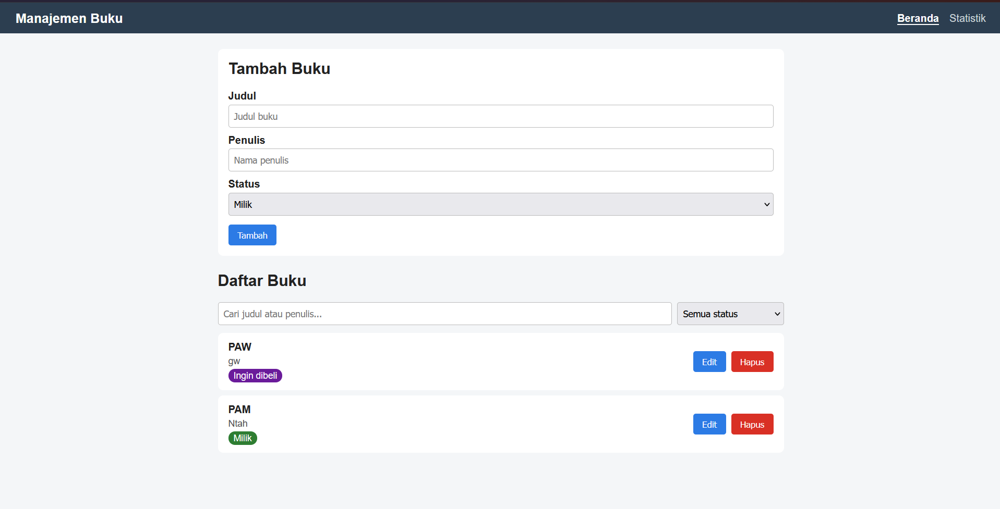
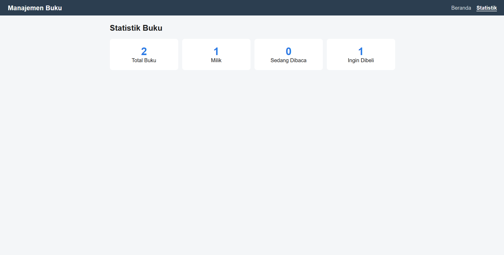
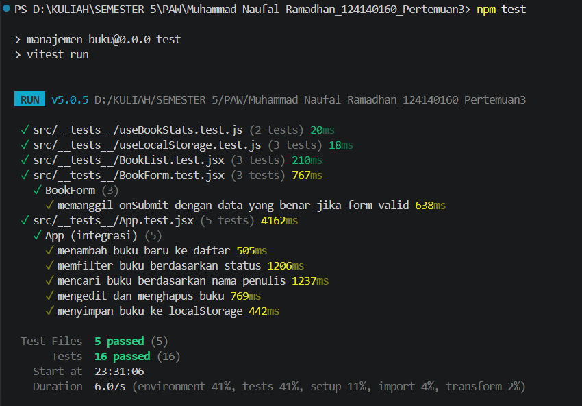

# Aplikasi Manajemen Buku Pribadi

Tugas Praktikum Pengembangan Aplikasi Web - Pertemuan 3 (React Basics)
Teknik Informatika, ITERA

## Deskripsi Aplikasi

Aplikasi untuk mencatat buku pribadi: buku yang **dimiliki**, **sedang dibaca**, atau **ingin dibeli**. Data disimpan di `localStorage` sehingga tidak hilang saat halaman di-refresh.

Fitur:
- Menambah buku baru (judul, penulis, status)
- Mengedit dan menghapus buku
- Filter buku berdasarkan status
- Pencarian buku berdasarkan judul atau nama penulis
- Halaman statistik jumlah buku per status
- Validasi form (judul dan penulis wajib diisi, input kosong diberi tanda merah dan pesan error)

## Cara Menjalankan

Pastikan Node.js sudah terpasang, lalu jalankan di terminal VS Code:

```bash
npm install
npm run dev
```

Buka alamat yang muncul di terminal (biasanya `http://localhost:5173`).

Menjalankan unit test:

```bash
npm test
```

## Screenshot

| Halaman | Screenshot |
| ------- | ---------- |
| Beranda (form + daftar buku) |  |
| Statistik |  |
| Hasil unit test (terminal) |  |

## Fitur React yang Digunakan

| Konsep | Penerapan |
| ------ | --------- |
| Functional components + Hooks | Semua komponen berupa function component |
| `useState` | State form, filter status, kata kunci pencarian, mode edit |
| `useEffect` | Menyimpan data ke localStorage (`useLocalStorage`) dan mengisi form saat mode edit (`BookForm`) |
| `useMemo` | Perhitungan statistik di `useBookStats` |
| Props + PropTypes | Semua komponen memakai PropTypes untuk type checking |
| Controlled components | Input form dikontrol lewat state |
| Conditional rendering | Pesan "belum ada buku", pesan error form, tombol Simpan/Batal saat edit |
| Rendering list + `key` | `BookList` me-render buku dengan `key={book.id}` |
| Context API | `BookContext` menyimpan daftar buku dan fungsi tambah/edit/hapus |
| React Router | Dua halaman: Beranda (`/`) dan Statistik (`/stats`) |
| Custom hooks | `useLocalStorage` dan `useBookStats` |
| Testing | Vitest + React Testing Library (16 test) |
