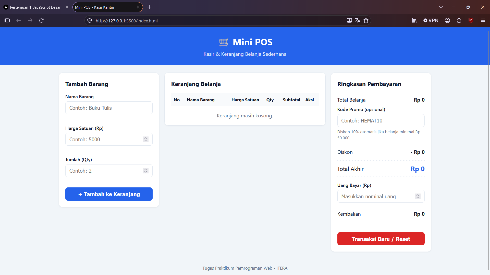
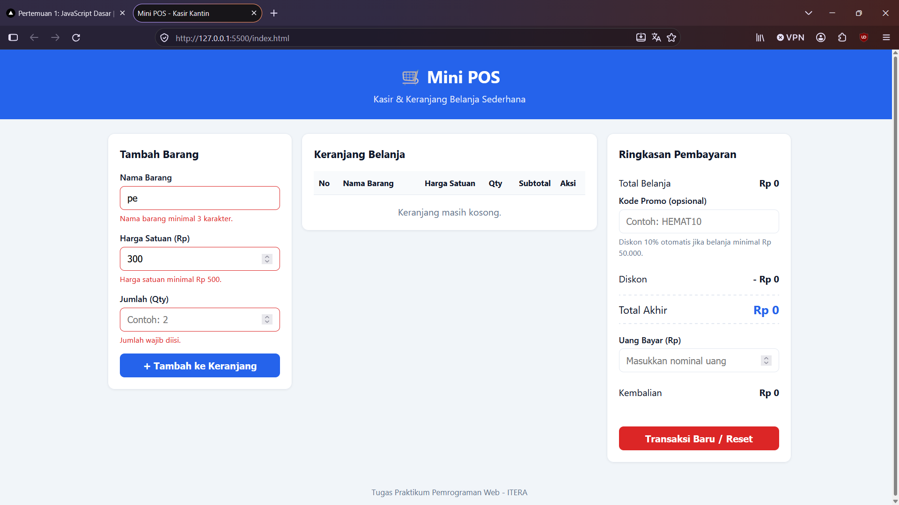
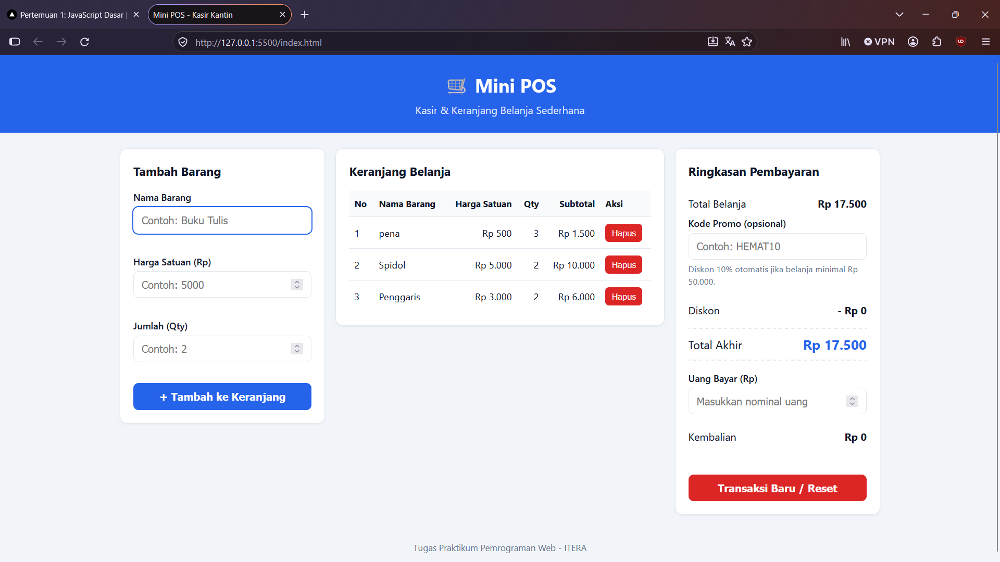

# Mini POS - Aplikasi Kasir & Keranjang Belanja Sederhana

## Identitas

- **Nama Lengkap:** Muhammad Naufal Ramadhan
- **NIM:** 124140160
- **Kelas Praktikum:** RA

## Deskripsi Aplikasi

Mini POS adalah aplikasi web kasir sederhana untuk kantin atau toko kampus. Kasir dapat memasukkan barang belanjaan, melihat daftar belanja beserta subtotal, mendapat potongan diskon otomatis, lalu menghitung kembalian dari uang yang dibayarkan pembeli.

**Tujuan pembuatan:** menggabungkan tiga kompetensi dasar praktikum JavaScript, yaitu validasi input form, perhitungan kalkulator otomatis, dan manajemen keranjang belanja dengan `localStorage`.

**Studi kasus:** kasir kantin / toko kampus.

## Panduan Menjalankan

1. Clone atau unduh repository ini.
2. Buka folder `Muhammad Naufal Ramadhan_124140160_pertemuan1` di VS Code.
3. Klik kanan `index.html`, lalu pilih **Open with Live Server** (ekstensi Live Server harus terpasang).
4. Aplikasi terbuka otomatis di browser. Alternatif: buka `index.html` langsung di browser.

## Daftar Fitur

- Validasi nama barang (wajib, minimal 3 karakter)
- Validasi harga satuan (angka positif, minimal Rp 500)
- Validasi qty (bilangan bulat, minimal 1)
- Pesan error merah di bawah input yang salah dan barang tidak masuk keranjang
- Form otomatis di-reset setelah berhasil menambah barang
- Tabel keranjang (No, Nama Barang, Harga Satuan, Qty, Subtotal, Aksi)
- Subtotal per baris dan total belanja otomatis
- Diskon 10% otomatis jika total belanja minimal Rp 50.000
- Kode promo `HEMAT10` (diskon 10%)
- Kalkulator uang bayar dan kembalian, dengan peringatan jika uang kurang
- Hapus item dengan perhitungan ulang otomatis
- Penyimpanan keranjang ke `localStorage` (tidak hilang saat refresh)
- Tombol Transaksi Baru / Reset
- Format Rupiah dan tampilan responsif

## Tangkapan Layar

| Tampilan | Gambar |
|---|---|
| Form input utama |  |
| Validasi error |  |
| Hasil perhitungan dan tabel |  |

## Penjelasan Teknis Singkat

**Penanganan validasi.** Saat form disubmit, `e.preventDefault()` menahan pengiriman default. Tiga fungsi (`validasiNama`, `validasiHarga`, `validasiQty`) mengembalikan pesan error, atau string kosong jika valid. Pesan ditampilkan merah di bawah input terkait. Jika salah satu tidak valid, fungsi berhenti dan barang tidak ditambahkan. Jika semua valid, barang ditambahkan dan form di-reset.

**Algoritma kalkulator.** `hitungTotalBelanja()` menjumlahkan `harga × qty` setiap item dengan `reduce()`. Fungsi `hitungTotal()` kemudian menghitung diskon 10% bila total ≥ Rp 50.000 atau kode `HEMAT10` valid (tidak ditumpuk), menghitung `Total Akhir = Total - Diskon`, dan `Kembalian = Uang Bayar - Total Akhir`. Jika uang kurang, ditampilkan selisih kekurangannya. Semua dihitung ulang setiap keranjang, kode promo, atau uang bayar berubah.

**Serialisasi localStorage.** Setiap perubahan keranjang (tambah, hapus) memanggil `simpanKeranjang()` yang menjalankan `localStorage.setItem(key, JSON.stringify(keranjang))`. Saat halaman dimuat, `muatKeranjang()` membaca data dengan `JSON.parse()` (dibungkus `try/catch` agar aman bila data rusak). Tombol reset memanggil `localStorage.removeItem()`.
