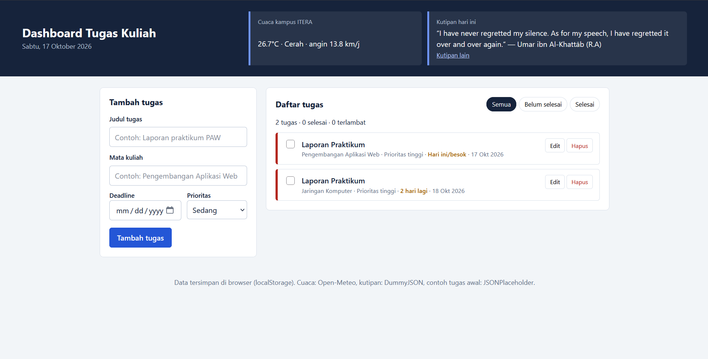

# Dashboard Tugas Kuliah

Tugas Praktikum Pengembangan Aplikasi Web (PAW) ITERA, Pertemuan 2: JavaScript Next Gen (ES6+).

## Fungsi Aplikasi

Dashboard Tugas Kuliah membantu mahasiswa mencatat tugas, mata kuliah, dan deadline di satu tempat, lalu melihat mana yang sudah selesai, mendekati deadline, atau terlambat. Di bagian atas ada cuaca kampus ITERA dan satu kutipan harian.

### Fitur

- **Tambah tugas**: judul, mata kuliah, deadline, dan prioritas (rendah, sedang, tinggi).
- **Edit tugas**: tombol Edit mengisi ulang formulir, lalu Simpan perubahan.
- **Hapus tugas**: tombol Hapus dengan konfirmasi.
- **Tandai selesai**: centang kotak di tiap tugas.
- **Filter**: Semua, Belum selesai, Selesai.
- **Ringkasan**: jumlah tugas, selesai, dan terlambat.
- **Penyimpanan lokal**: seluruh data disimpan di `localStorage`, jadi tetap ada setelah halaman ditutup.
- **Cuaca kampus ITERA** dari Open-Meteo dan **kutipan harian** dari DummyJSON (tombol "Kutipan lain").
- **Contoh tugas awal** dari JSONPlaceholder, hanya dimuat saat aplikasi pertama kali dibuka.
- Jika internet mati, aplikasi tetap bisa dipakai. Widget menampilkan pesan gagal muat.

## Screenshot



## Cara Menjalankan

Aplikasi memakai `type="module"`, jadi buka folder ini di VS Code, klik kanan `index.html`, lalu pilih **Open with Live Server**.

## Struktur Kode

```text
personal-dashboard/
├── index.html
├── css/style.css
└── js/
    ├── TaskItem.js        class model satu tugas
    ├── DashboardApp.js    class state, localStorage, dan fetch API
    └── main.js            render DOM dan event handler
```

## Daftar Fitur ES6+ yang Diimplementasikan

| Fitur ES6+ | File dan baris |
| --- | --- |
| `let` dan `const` | `let editingId` di `js/main.js:8`; `const` untuk nilai tetap di `js/main.js:5-6`, `js/DashboardApp.js:5-20` |
| **Arrow functions** (lebih dari 3) | `js/main.js:6`, `11`, `16`, `21`, `30`, `48`, `65`, `71`, `80`, `98`, `121`, `133`; `js/DashboardApp.js:37`, `61`, `71`, `86-88`, `93`, `98`, `133` |
| **Template literals** untuk rendering dinamis | HTML kartu tugas `js/main.js:32-45`; label deadline `js/main.js:22-26`; ringkasan `js/main.js:55`; id unik `js/TaskItem.js:25`; pesan error `js/DashboardApp.js:110` |
| **Async/Await** | `fetchJson` `js/DashboardApp.js:108`; `fetchWeather` `js/DashboardApp.js:114`; `fetchQuote` `js/DashboardApp.js:123`; `seedFromApi` `js/DashboardApp.js:129`; pemanggil di UI `js/main.js:148`, `158`, `169` |
| **Classes** | `class TaskItem` `js/TaskItem.js:4`; `class DashboardApp` `js/DashboardApp.js:22`; getter `js/TaskItem.js:33`, `38` dan `js/DashboardApp.js:84`, `96`; static method `js/TaskItem.js:24`, `28` |
| Destructuring | Parameter + default value `js/TaskItem.js:6-14`; `js/TaskItem.js:50`; parameter fungsi `js/DashboardApp.js:53`, `87-88`, `133`; nested `js/DashboardApp.js:115`; `js/main.js:21`, `31`, `49`, `84`, `100`, `122` |
| Spread operator (state immutable) | `js/DashboardApp.js:55`, `139`; `js/TaskItem.js:46` |
| Default parameters | `js/TaskItem.js:6-14`; `js/DashboardApp.js:23`; `js/main.js:65` |
| ES Modules (`import`/`export`) | `js/main.js:3`, `js/DashboardApp.js:3` |
| Nullish coalescing (`??`) | `js/DashboardApp.js:29`, `92`, `119` |

## Penyimpanan Data (`localStorage`)

- Key: `dashboard-tugas-kuliah:tasks`
- `DashboardApp.load()` (`js/DashboardApp.js:33`) membaca dan mengubah JSON kembali menjadi objek `TaskItem`.
- `DashboardApp.save()` (`js/DashboardApp.js:44`) dipanggil setiap kali tugas ditambah, diubah, dicentang, atau dihapus.
- Pembacaan dan penulisan dibungkus `try/catch` agar aplikasi tidak error bila data rusak.

## API Publik yang Dipakai

| Kegunaan | Endpoint |
| --- | --- |
| Cuaca kampus ITERA | `https://api.open-meteo.com/v1/forecast?latitude=-5.36&longitude=105.31&current_weather=true` |
| Kutipan harian | `https://dummyjson.com/quotes/random` |
| Contoh tugas awal | `https://jsonplaceholder.typicode.com/todos?_limit=5` |
