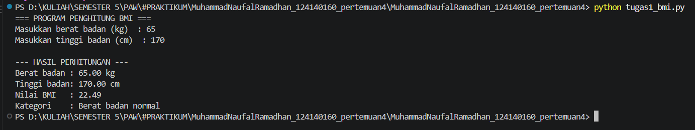
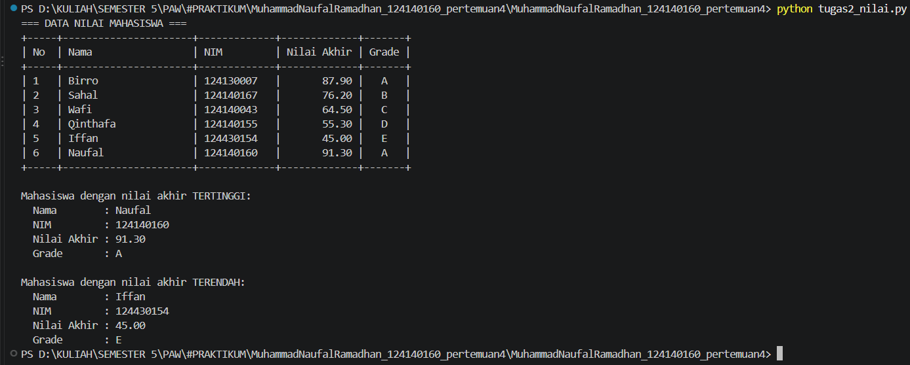
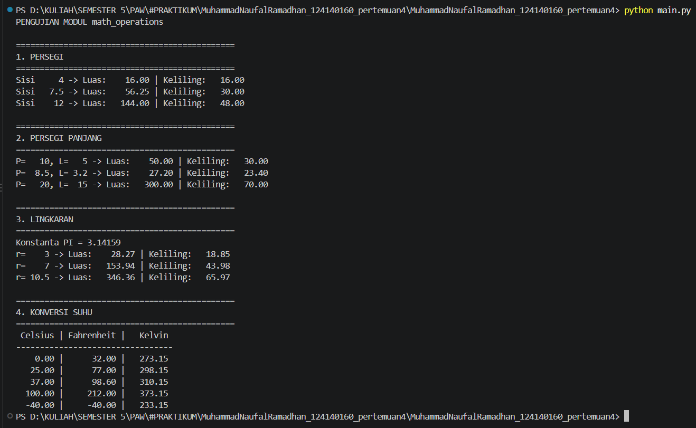

# Praktikum Pengembangan Aplikasi Web - Pertemuan 4: Python Dasar

## Identitas Mahasiswa

| Keterangan | Isi |
|------------|-----|
| Nama       | Muhammad Naufal Ramadhan |
| NIM        | 124140160 |
| Kelas      | RA |
| Program Studi | Teknik Informatika, ITERA |

## Struktur Folder

```
[NAMA]_[NIM]_pertemuan4/
├── .gitignore
├── README.md
├── tugas1_bmi.py
├── tugas2_nilai_mahasiswa.py
├── math_operations.py
└── main.py
```

## Deskripsi Program

### Soal 1 - `tugas1_bmi.py` (Penghitung BMI)
Alur kerja:
1. Program meminta input berat badan (kg) dan tinggi badan (m) melalui `input()`. Input divalidasi (harus angka dan lebih dari 0).
2. Fungsi `hitung_bmi(berat, tinggi)` menghitung `BMI = berat / (tinggi * tinggi)`.
3. Fungsi `tentukan_kategori(bmi)` memakai `if-elif-else`:
   - BMI < 18.5: Berat badan kurang
   - 18.5 <= BMI < 25: Berat badan normal
   - 25 <= BMI < 30: Berat badan berlebih
   - BMI >= 30: Obesitas
4. Nilai BMI (2 angka desimal dengan f-string) dan kategori dicetak ke terminal.

### Soal 2 - `tugas2_nilai_mahasiswa.py` (Pengelolaan Nilai Mahasiswa)
Alur kerja:
1. Data disimpan dalam **list berisi 6 dictionary** dengan kunci `nama`, `nim`, `nilai_uts`, `nilai_uas`, `nilai_tugas`.
2. `hitung_nilai_akhir()` menghitung `(30% * UTS) + (40% * UAS) + (30% * Tugas)`.
3. `tentukan_grade()` menentukan grade: A (>= 80), B (70-79), C (60-69), D (50-59), E (< 50).
4. `cetak_tabel()` menampilkan Nama, NIM, Nilai Akhir, dan Grade dalam tabel rapi menggunakan perataan f-string.
5. Mahasiswa dengan nilai akhir **tertinggi** dan **terendah** dicari dengan `max()` dan `min()` lalu ditampilkan.

### Soal 3 - `math_operations.py` dan `main.py` (Modul Matematika)
- `math_operations.py` (modul) berisi:
  - Konstanta `PI = 3.14159`
  - Luas & keliling: persegi, persegi panjang, lingkaran
  - Konversi suhu: `celsius_ke_fahrenheit()` dan `celsius_ke_kelvin()`
- `main.py` mengimpor modul dan memanggil **seluruh fungsi** dengan beberapa nilai uji, lalu mencetak hasil dalam format rapi. Tiga cara impor dipakai:
  - `import math_operations`
  - `from math_operations import PI, luas_lingkaran, ...`
  - `import math_operations as mo`

## Cara Menjalankan

Pastikan Python 3.8+ terpasang (`python --version`). Buka terminal di VS Code pada folder ini, lalu jalankan:

```bash
python tugas1_bmi.py
python tugas2_nilai.py
python main.py
```

(Gunakan `python3` jika `python` tidak dikenali.)

## Screenshot Hasil Eksekusi

### Soal 1 - tugas1_bmi.py  


### Soal 2 - tugas2_nilai.py  


### Soal 3 - main.py  


## Catatan
- Seluruh fungsi dilengkapi docstring (parameter dan nilai kembalian).
- Kode mengikuti PEP 8: indentasi 4 spasi dan penamaan `snake_case`.
- Folder `venv/` dan `__pycache__/` tidak diunggah (terdaftar di `.gitignore`).
